# PCB Design Portfolio

Boards I designed: schematics, 2 and 4-layer layouts and 3D models, routed to JLCPCB manufacturing rules.

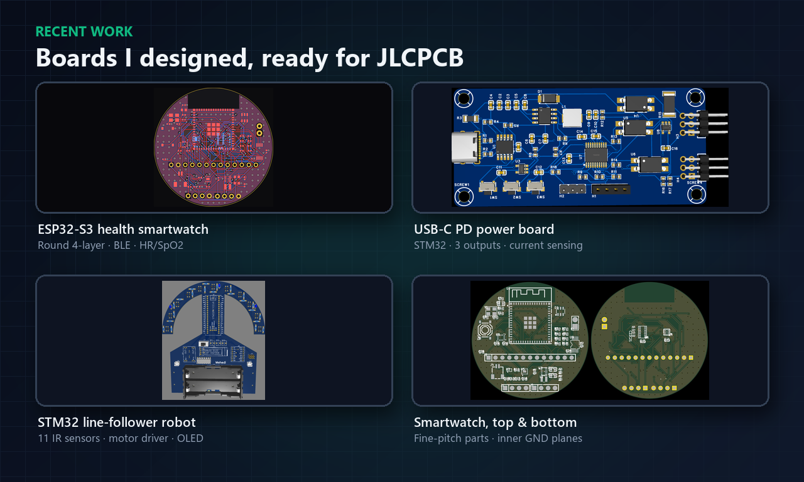

**Tools:** KiCad · EasyEDA · Altium Designer
**Work with me:** [Fiverr](https://www.fiverr.com/mehedi_eee) · [LinkedIn](https://www.linkedin.com/in/md-mehedi-hassan-3266a9297/)

| Project | Layers | Controller | Highlights |
|---|---|---|---|
| [ESP32-S3 Health Smartwatch](#1-esp32-s3-health-smartwatch) | 4 | ESP32-S3-MINI-1 | Round 42.9 mm board, HR/SpO2, skin temp, IMU, LiPo charging, haptics |
| [USB-C PD Power Board](#2-usb-c-pd-multi-channel-power-board) | 2 | STM32F070 | USB-C PD input, buck + LDO, 3 isolated outputs, current sensing |
| [STM32 Line-Follower Robot](#3-stm32-line-follower-robot-board) | 2 | STM32F411 Black Pill | 11-sensor IR arc, TB6612FNG motor driver, OLED, 2S 18650 power |

---

## 1. ESP32-S3 Health Smartwatch

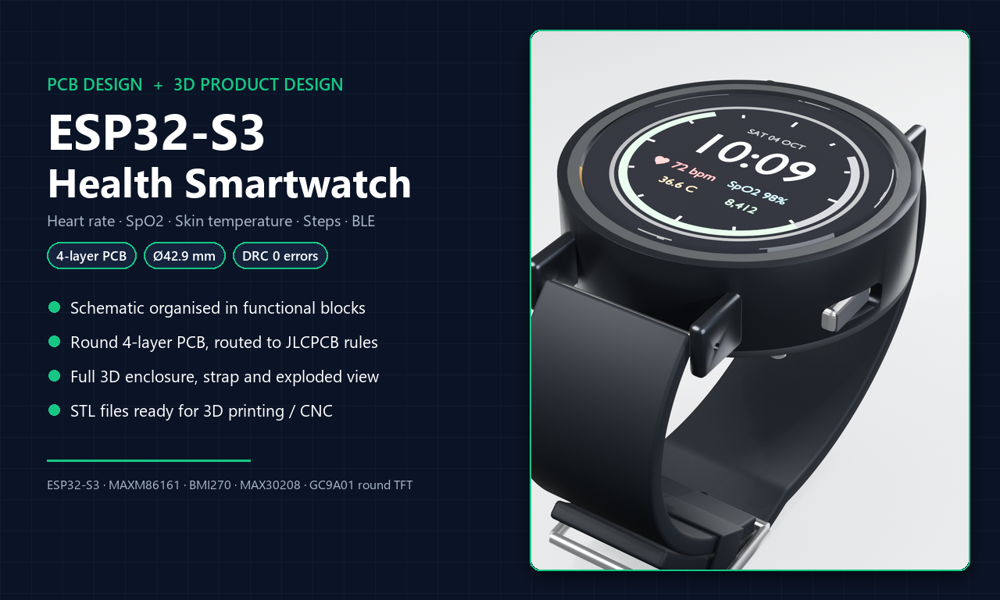

A round 4-layer PCB (42.9 mm) for a health smartwatch, with a full 3D enclosure and strap.

- **ESP32-S3-MINI-1** (Wi-Fi + Bluetooth LE) with a 32.768 kHz crystal for low-power BLE
- **MAXM86161** optical sensor for heart rate and SpO2, on the skin side
- **MAX30208** skin-temperature sensor and **BMI270** IMU for steps and wrist-raise wake
- **BQ25180** LiPo charger with power path, **MAX17048** fuel gauge, NTC protection
- **TPS63802** buck-boost for a stable 3.3 V rail down to a low battery
- **DRV2605L** haptic driver, USB with ESD protection, round TFT display header
- Sensor and display I2C buses kept apart; solid ground planes on the inner layers
- Routed to JLCPCB 4-layer rules with **0 DRC errors**

| PCB (3D) | Layout |
|---|---|
| 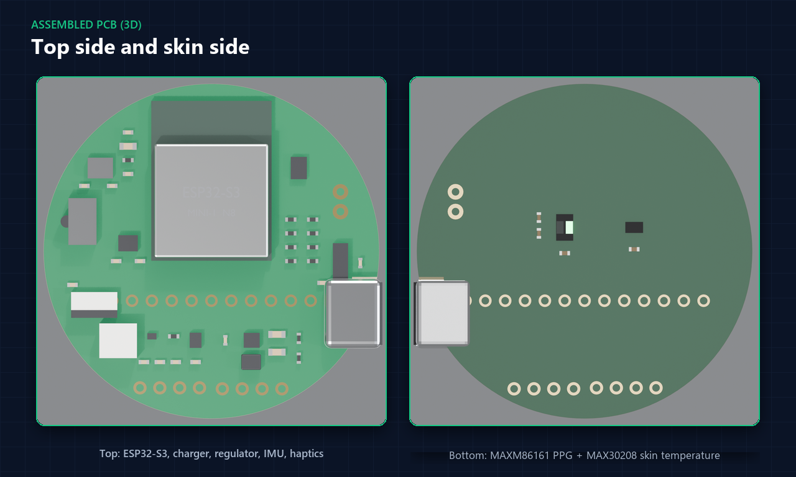 | 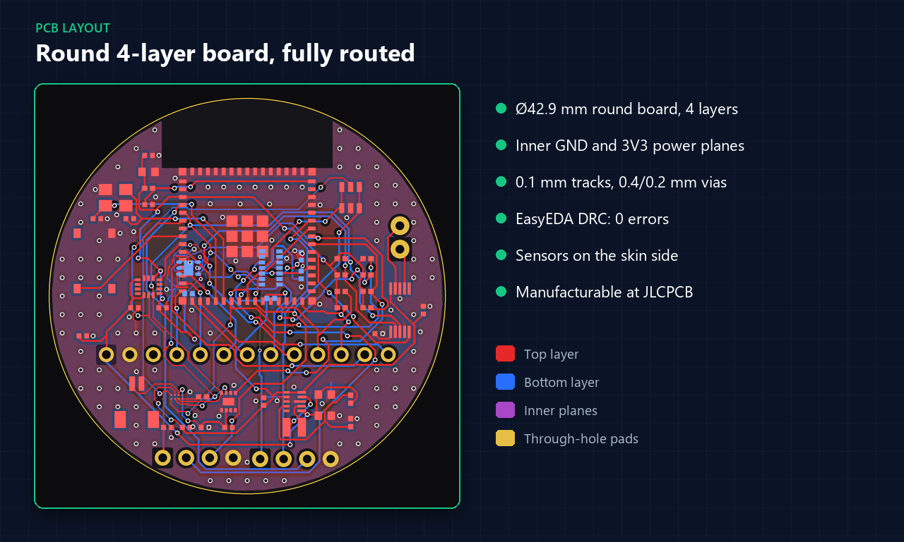 |

| Schematic | Enclosure (exploded) |
|---|---|
| 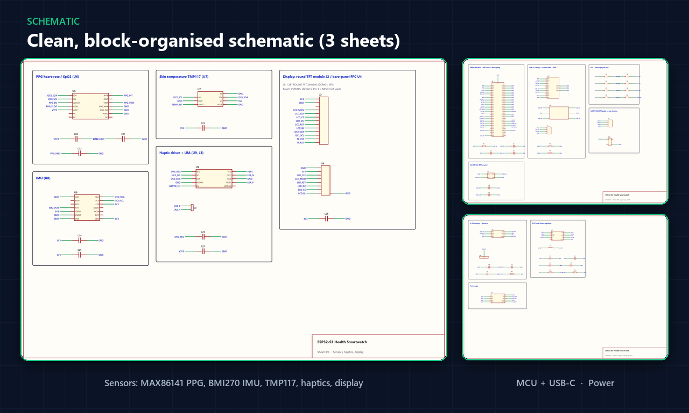 | 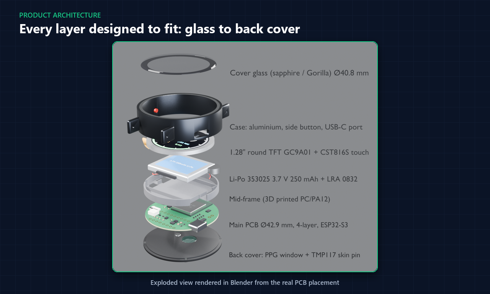 |

---

## 2. USB-C PD Multi-Channel Power Board

A compact 2-layer control board that takes power from USB-C PD and switches three isolated outputs, with current and voltage monitoring. Designed in EasyEDA.

- USB-C PD input with the **CH224K** trigger IC (selectable PD voltage)
- **TPS54331** buck converter for 3.3 V, plus a **TLV75718** 1.8 V LDO
- **STM32F070F6P6** controller with SWD header
- 3 solid-state outputs (**GAQY212GH** PhotoMOS relays)
- **INA180** load-current sensing with a 10 mΩ shunt, plus output-voltage ADC
- I2C OLED header, 3 buttons, reset circuit, 4× M3 mounting holes

| PCB (3D) | Layout |
|---|---|
| 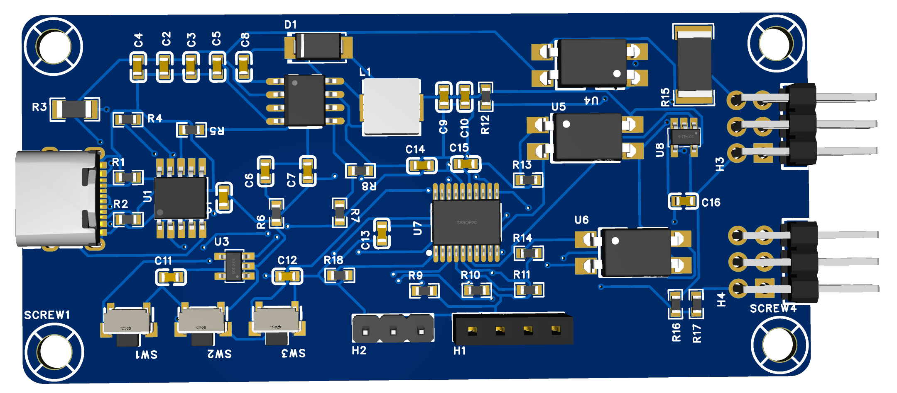 | 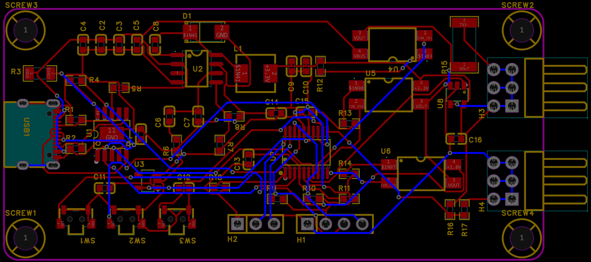 |

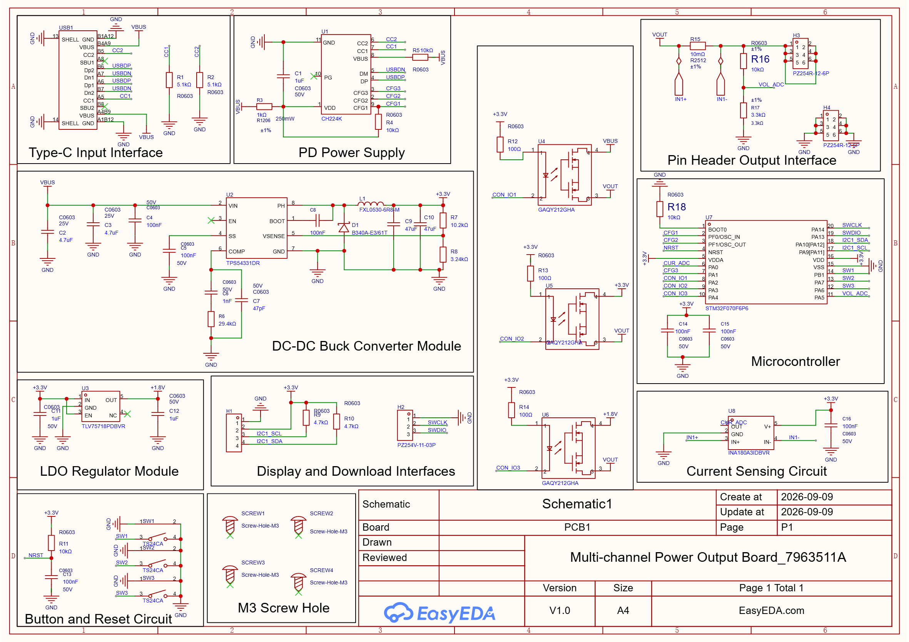

---

## 3. STM32 Line-Follower Robot Board

A 2-layer main board for a competition line-follower robot. The board doubles as the chassis, with a curved front arc that holds the sensors.

- **STM32F411CEU6** Black Pill with SWD header
- **11 IR sensors** on a curved arc for wide, stable line tracking
- **TB6612FNG** dual motor driver with JST motor connectors
- 0.91" SSD1306 OLED and 3 buttons for tuning on the track
- 2S 18650 holder with BMS, charging module, power switch and regulator

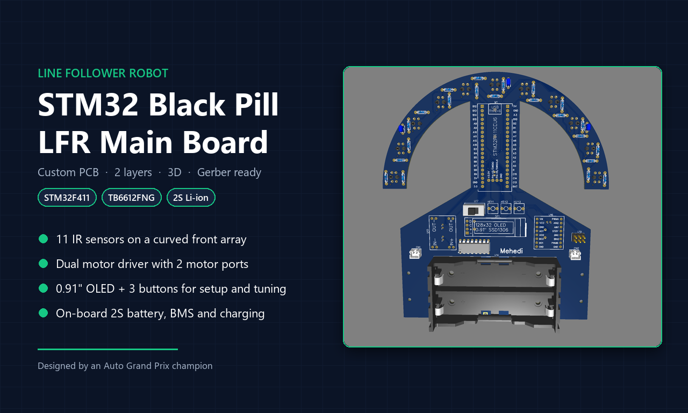

| Layout + 3D | Both copper layers |
|---|---|
| 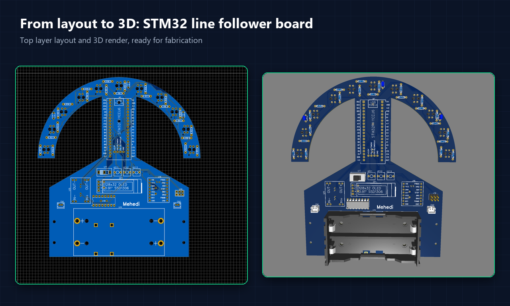 | 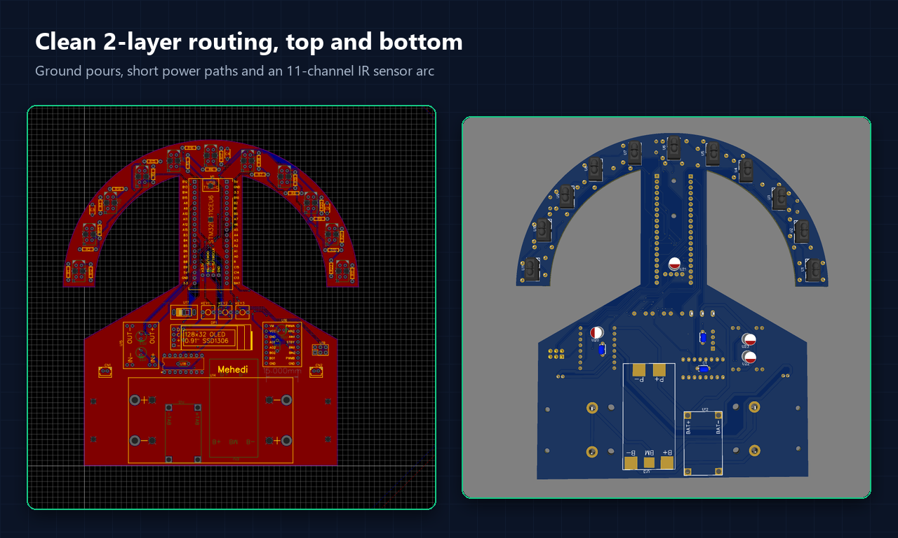 |

---

## What I deliver for client boards

Schematic (PDF + source) · routed 2/4-layer PCB · Gerber + drill files · BOM · pick-and-place · 3D model · DRC/ERC report

Need a board designed, reviewed before ordering, or a breadboard project turned into a PCB? Message me on [Fiverr](https://www.fiverr.com/mehedi_eee).
